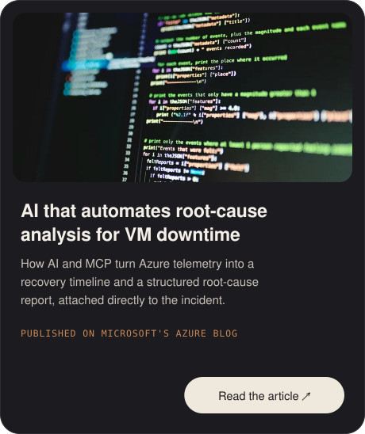
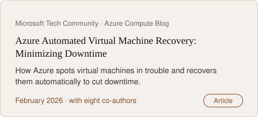
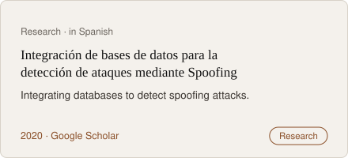

  &nbsp;
  &nbsp;
  

**Tools I reach for**

  &nbsp;&nbsp;
  &nbsp;&nbsp;
  &nbsp;&nbsp;
  &nbsp;&nbsp;
  &nbsp;&nbsp;
  &nbsp;&nbsp;
  &nbsp;&nbsp;
  &nbsp;&nbsp;
  &nbsp;&nbsp;
  &nbsp;&nbsp;
  &nbsp;&nbsp;
  &nbsp;&nbsp;
  &nbsp;&nbsp;
  

 

### GitHub contributions in the last year

Each square is a day of commits and other contributions, private work included. The snake eats them in order.

<picture>
  <source media="(prefers-color-scheme: dark)" srcset="https://raw.githubusercontent.com/jandoni/jandoni/output/snake-dark.svg">
  
</picture>

### Publications

