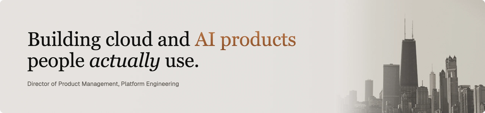
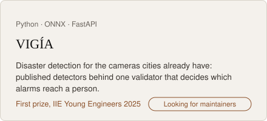
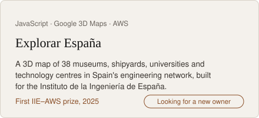
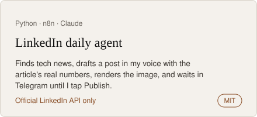
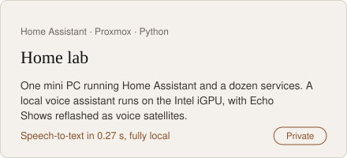

### Activity

Redrawn every day by <a href="scripts/activity.py">a small script</a> from the public contribution calendar. Most of my work is in private repositories, so it shows up here as counts only.

### Tools I reach for

  &nbsp;&nbsp;
  &nbsp;&nbsp;
  &nbsp;&nbsp;
  &nbsp;&nbsp;
  &nbsp;&nbsp;
  &nbsp;&nbsp;
  &nbsp;&nbsp;
  &nbsp;&nbsp;
  &nbsp;&nbsp;
  &nbsp;&nbsp;
  &nbsp;&nbsp;
  &nbsp;&nbsp;
  &nbsp;&nbsp;
  

Most of my cloud work has been on Azure and AWS, with migrations across Google
Cloud too. Certified PMP, AWS Cloud Practitioner and Azure Fundamentals.

### Selected work

### Publications

---

<a href="https://jonandonibaranda.com">jonandonibaranda.com</a> · <a href="https://www.linkedin.com/in/jon-andoni-baranda/">LinkedIn</a> · <a href="https://scholar.google.com/citations?user=bZPQs6kAAAAJ">Google Scholar</a>
